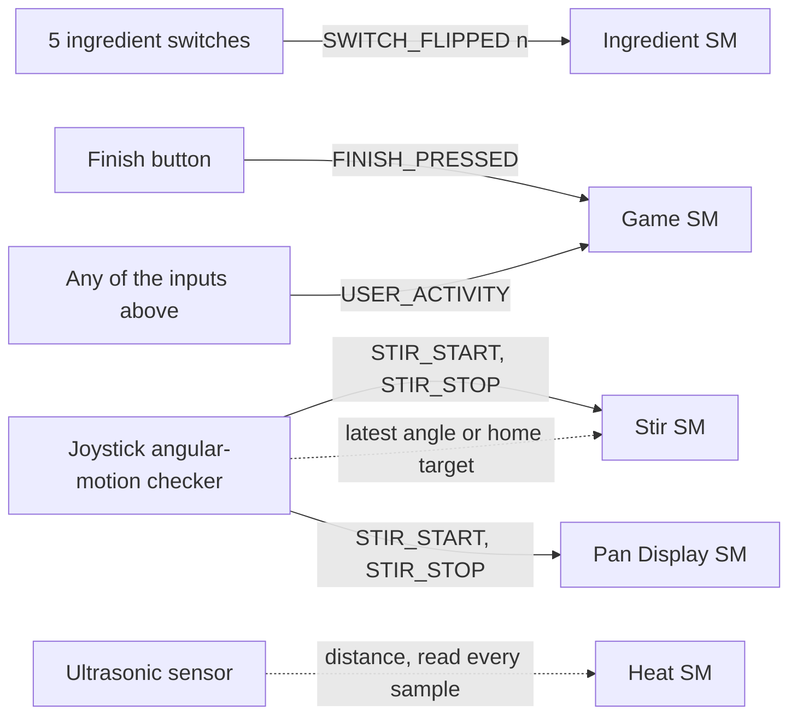
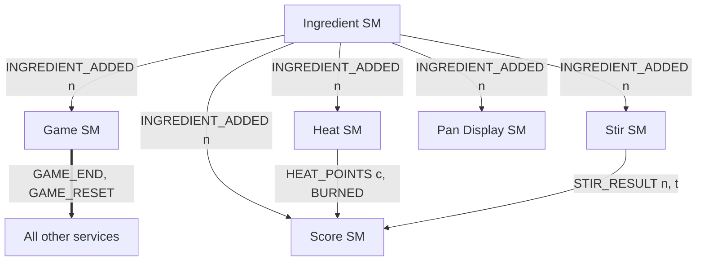
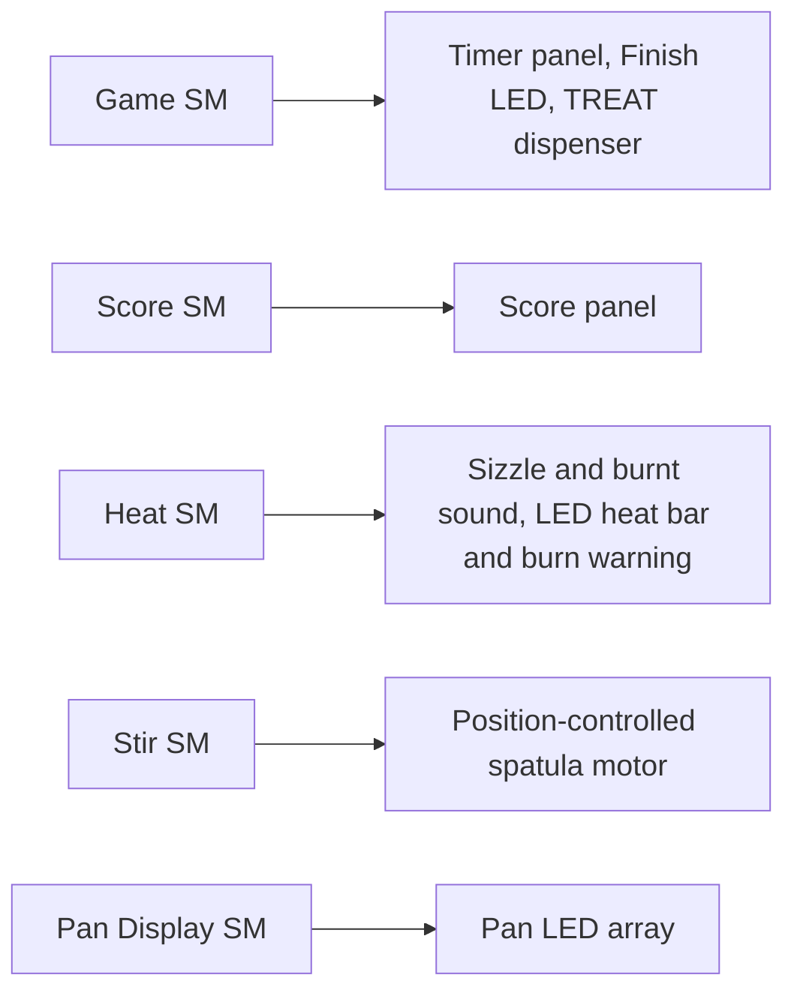
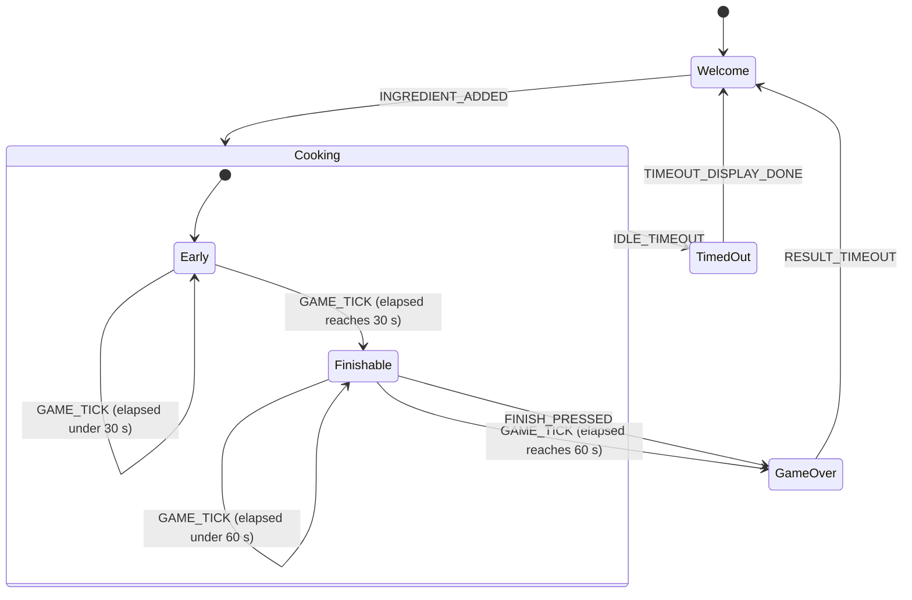
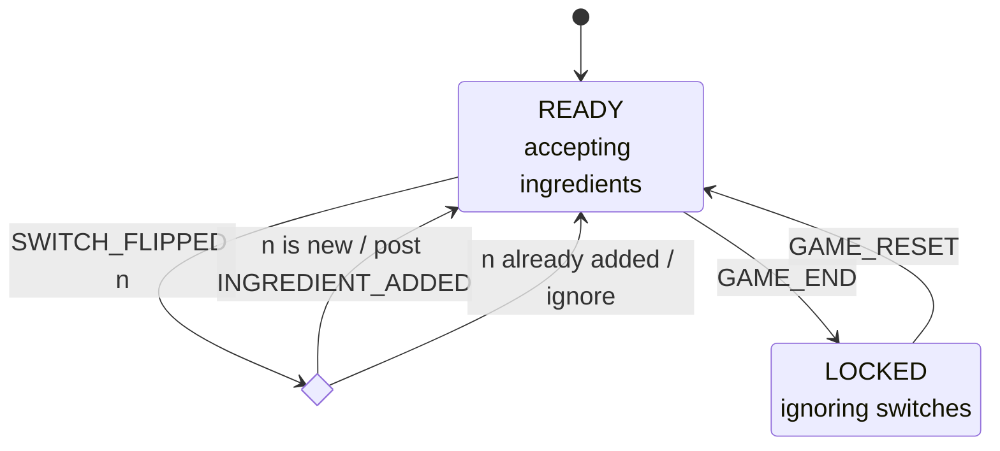
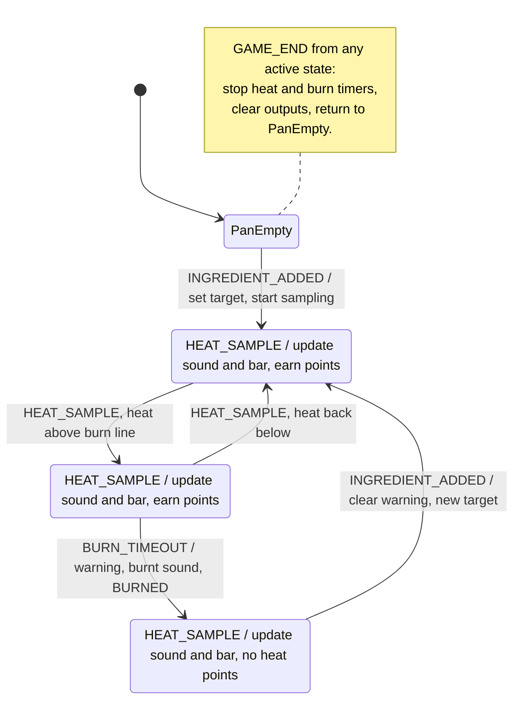
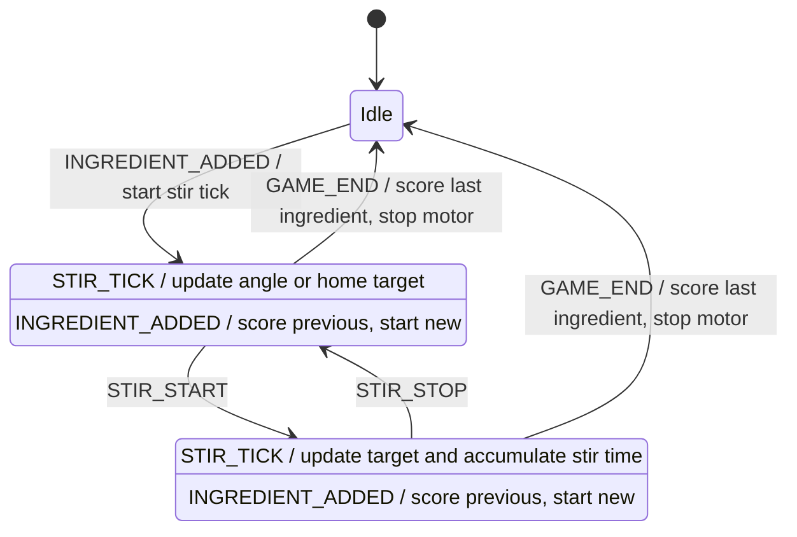
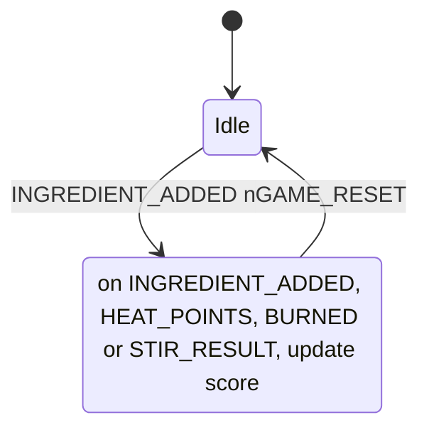
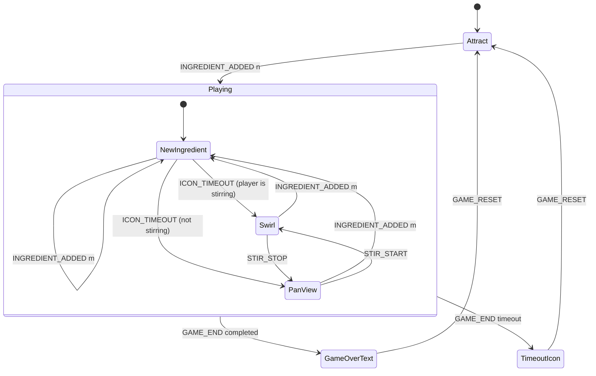

# Panic at the Pan — State Machine Design (Draft 2)

ME 218a Team 12 · Karl’s Kitchen CHEF

**November 8, 2026:** Heat-bar output and joystick-following spatula are confirmed. Flip detection, flip animation, and flip-related Game/Score changes are optional (§9). Firmware has not been updated.

The game runs as six cooperating services on one PIC32 using the Events and Services framework. Each service is a small state machine. They run “in parallel” by passing events, so a player can heat, add ingredients and stir at the same time without one giant flat FSM.

Values that are just numbers (heat target, elapsed time, stir time, score) are **variables**, not states. States only capture changes in *behavior*.

---

## 1. System overview — who talks to whom

The overview is split into three smaller pictures so each one stays readable: what feeds the machines, how the machines talk to each other, and what each machine drives.

### 1a. Inputs to the state machines

### 1b. Events between the state machines

### 1c. State machines to outputs

Each output device has exactly **one owner**, so no two machines ever fight over the same display, speaker or servo.

---

## 2. Game SM (top level)

Owns the game clock, the 20 s idle timer and the Finish button.

| State | Entry actions | Events handled inside (no state change) |
|---|---|---|
| **Welcome** | Post `GAME_RESET` to all services. Timer panel shows 0:00. Finish LED off. | — |
| **Cooking** (on entry from Welcome) | elapsed = 0. Start 1 s `GAME_TICK` timer. Start 20 s `IDLE_TIMER`. | `USER_ACTIVITY` → restart `IDLE_TIMER` |
| **Early** (0–30 s) | Finish LED off. | `GAME_TICK` → elapsed++, update timer panel, restart tick. `FINISH_PRESSED` → **ignored** (protects the 30 s minimum). |
| **Finishable** (30–60 s) | Finish LED on (lit button = “you may stop now”). | `GAME_TICK` → elapsed++, update timer panel, restart tick. |
| **GameOver** | Stop tick and idle timers. Post `GAME_END(completed)` to all. Dispense TREAT. Start `RESULT_TIMER` (e.g. 10 s, must be ≤ 30 s). | — |
| **TimedOut** | Stop tick timer. Post `GAME_END(timeout)` to all. **No TREAT.** Start `TIMEOUT_DISPLAY` timer (e.g. 5 s). | — |

---

## 3. Ingredient SM

Turns switch flips into ingredient events. Ingredient order does not matter; each ingredient can be added once per game.

This machine has only **two states**:

- **READY** accepts ingredients. It is the state at power-up, in Welcome mode, and during the whole game.
- **LOCKED** ignores every switch. It is the state while the score and GAME OVER (or the timeout) are shown.

The diamond is **not a state**. It is a **choice point**: the machine stops there for zero time to ask one question, “has ingredient n already been added this game?” Either answer leads straight back to READY.

**Walkthrough:**

1. Player flips the chicken switch. Chicken is new, so the machine posts `INGREDIENT_ADDED(chicken)` and stays in READY. (This first ingredient also starts the game.)
2. Player flips the onion switch. Onion is new, so it is posted and the machine stays in READY.
3. Player flips chicken again. Chicken was already added, so nothing happens and the machine stays in READY.
4. Time hits 60 s. Game SM posts `GAME_END`, and the machine moves to LOCKED. Switch flips now do nothing.
5. Score display finishes. Game SM posts `GAME_RESET`. The machine clears its list of added ingredients and returns to READY for the next player.

| From | Event | Guard | Actions | To |
|---|---|---|---|---|
| Ready | `SWITCH_FLIPPED n` | ingredient n **not** added yet | Mark n as added. Post `INGREDIENT_ADDED(n)` to Game, Heat, Stir, Score, Pan Display. | Ready |
| Ready | `SWITCH_FLIPPED n` | ingredient n already added | None (ignore repeat flips). | Ready |
| Ready | `GAME_END` | — | None. | Locked |
| Locked | `SWITCH_FLIPPED n` | — | None (ignored). | Locked |
| Locked | `GAME_RESET` | — | Clear all five “added” flags. | Ready |

The very first `INGREDIENT_ADDED` of a game is also what moves the Game SM from Welcome to Cooking. The Ingredient SM doesn’t need to know that. It treats every ingredient the same way. Whether an ingredient is right or wrong for the recipe is decided by the Score SM, not here.

---

## 4. Heat SM — confirmed

Keep the four existing states. Hand distance controls continuous heat; the LED bar shows heat level. **Remove all flame-servo actions.** Heat owns the heat bar and its burn warning; the warning pattern is TBD and must preserve readable heat feedback.

| State | Entry / exit | On `HEAT_SAMPLE` (100 ms) |
|---|---|---|
| **PanEmpty** | Sound and heat bar off; warning cleared. Stop heat/burn timers. | Ignore samples. First ingredient sets target and starts sampling. |
| **Cooking** | Clear any previous burn warning. | Compute heat, update sound/bar, post `HEAT_POINTS(closeness)`, restart sample timer. |
| **Overheating** | Entry: start 3 s burn timer. Exit: cancel it. | Same heat outputs and points as Cooking. |
| **Burning** | Entry: show burn warning, play burnt sound and post `BURNED` once. Exit: clear warning. | Continue heat indication; no heat points. |

- Burn line remains **1.5 × target**. Sustained overheating for 3 s burns the ingredient.
- A burnt ingredient stays burnt until the next ingredient or game end. Lowering heat does not clear it.
- In Cooking/Overheating, a new ingredient updates the target; the next sample rechecks the threshold, as in Draft 1.
- Heat scoring stays continuous: `closeness = max(0, 1 − |heat − target| / target)`. The finite number of bar segments does not change scoring.
- `GAME_RESET` clears timers and outputs and returns to PanEmpty. Burn-warning appearance and threshold hysteresis remain TBD.

---

## 5. Stir SM — confirmed

Keep **Idle**, **NotStirring** and **Stirring**. One motor positions the spatula like a clock hand: joystick X/Y direction commands angle; centering commands a fixed home angle. Angle and target are variables, not separate states.

| Event | Actions |
|---|---|
| First `INGREDIENT_ADDED n` | Set current ingredient; zero stir time; initialize motion detection; start 50 ms `STIR_TICK`. |
| `STIR_TICK` during cooking | Update motor target from latest joystick direction or home command. Restart tick. Accumulate time only in Stirring. |
| `STIR_START` | Enter Stirring when qualifying player-directed angular movement begins. |
| `STIR_STOP` | Enter NotStirring when movement stops or the joystick centers. Motor still follows its target. |
| Later `INGREDIENT_ADDED m` | Post previous `STIR_RESULT`; select m and zero its stir time. |
| `GAME_END` while active | Post final `STIR_RESULT` once, stop tick and motor motion, clear motion detection, enter Idle. Ignore later stir/tick events while Idle. |
| `GAME_RESET` | Stop tick/motor, clear ingredient and stir-time records, enter Idle without scoring. |

**Motion detection:** the joystick checker uses changes in commanded angle, not merely deflection. A held joystick commands a stationary angle and must not earn continuous stir time. Treat wraparound (359° → 0°) as a small angle change. Publish the latest angle/home target for Stir and post `STIR_START` / `STIR_STOP` to Stir and Pan Display.

The input-based detector does not prove actual motor motion. Motor selection, position feedback and startup referencing remain TBD. Motor movement must be nonblocking; reaching home does not need a new gameplay state.

**Still TBD:** home angle, center deadband, movement threshold/debounce, maximum speed and wraparound travel policy. Recommended scoring rule: automatic return-home motion earns no stir points; the baseline detector treats centering as `STIR_STOP`. Pan-lift interlocks are optional and not included here.

---

## 6. Score SM

The only code allowed to change the score. The score panel shows a live number for the whole game.

| Event | Score change (then refresh score panel) |
|---|---|
| Enter **Idle** | score = 0, panel shows 0. |
| `INGREDIENT_ADDED n` | + points if n is in today’s recipe, − points if not. |
| `HEAT_POINTS(c)` | + k × c (continuous). |
| `BURNED` | − burn penalty. |
| `STIR_RESULT(n, t)` | + points that shrink as \|t − optimalStir[n]\| grows. |

Score deliberately ignores `GAME_END`. The final `STIR_RESULT` arrives just after the game ends and must still count. The other machines stop sending points once they receive `GAME_END`.

---

## 7. Pan Display SM

Owns the pan LED array and decides what shows when several machines want it.

| State | What the pan array shows |
|---|---|
| **Attract** | Pulsing dish icon to invite play (animation timer). |
| **NewIngredient** | Large icon of the ingredient just added (e.g. chicken drumstick) for ~1.5 s (`ICON_TIMER`). |
| **PanView** | Small icons of everything currently in the pan. |
| **Swirl** | Swirl animation while the joystick is stirring. |
| **GameOverText** | “GAME OVER”. |
| **TimeoutIcon** | Pictorial timeout (e.g. sleeping chef or hourglass). |

New-ingredient icons take priority over the swirl. A swirl that starts during an icon is shown once the icon finishes.

---

## 8. Event dictionary

| Event | Parameter | Posted by | Posted to |
|---|---|---|---|
| `SWITCH_FLIPPED` | switch n | Switch event checker (debounced, edge) | Ingredient |
| `FINISH_PRESSED` | — | Button event checker | Game |
| `STIR_START` / `STIR_STOP` | — | Joystick angular-motion checker (not simple deflection) | Stir, Pan Display |
| `USER_ACTIVITY` | — | All input event checkers | Game |
| `INGREDIENT_ADDED` | ingredient n | Ingredient | Game, Heat, Stir, Score, Pan Display |
| `HEAT_POINTS` | closeness c | Heat | Score |
| `BURNED` | — | Heat | Score |
| `STIR_RESULT` | ingredient n, stir time t | Stir | Score |
| `GAME_END` | completed / timeout | Game | all services |
| `GAME_RESET` | — | Game | all services |
| `GAME_TICK`, `IDLE_TIMEOUT`, `RESULT_TIMEOUT`, `TIMEOUT_DISPLAY_DONE` | — | Framework timers | Game |
| `HEAT_SAMPLE`, `BURN_TIMEOUT` | — | Framework timers | Heat |
| `STIR_TICK` | — | Framework timer | Stir |
| `ICON_TIMEOUT` | — | Framework timer | Pan Display |

---

## 9. Optional changes — outside the confirmed baseline

These three additions are **optional**. They are not included in the active diagrams or event dictionary above.

| Optional addition | Proposed behavior | Decisions still needed |
|---|---|---|
| **Flip detection** | `Armed → Triggered → Armed`; emit one `PAN_FLIPPED` at the trigger, then wait for return before rearming. | Angle threshold vs. handle switch; debounce; return condition and startup state. |
| **Pan Display: flip animation** | During cooking, `PAN_FLIPPED` starts `FlipAnimation`; completion returns to the appropriate cooking display. Game end interrupts it. | Animation, duration, priority vs. ingredient icons/swirl, and repeated-flip handling. |
| **Game / Score: flip handling** | Optionally treat a flip as `USER_ACTIVITY` and optionally award a bonus. | Idle reset and bonus are separate decisions; no flip bonus is currently counted. |

Whether lifting pauses heat scoring or spatula motion is also undecided. No new service is required by this draft; the flip detector's implementation/owner remains TBD.

---

## 10. Assumptions and remaining decisions

1. **Game start:** the first ingredient switch both starts the game and counts as an ingredient.
2. **Heat target:** set by the most recently added ingredient.
3. **Burning (confirmed):** a burnt ingredient stays burnt. The burn warning remains and heat scoring stops until the next ingredient is added. The burn penalty is applied once per burn.
4. **Timeout:** any switch, Finish press, joystick stir, or hand entering ultrasonic range counts as activity. A timed-out game gives no TREAT.
5. **Switch reset:** switches are read on *edges* (any change counts as adding), so the next player doesn’t have to flip them back. Momentary levers would avoid the issue entirely.
6. **Pan flip:** the three additions in §9 are optional. Neither a gyroscope nor a specific sensor has been selected.
7. **Hysteresis:** consider returning from Overheating to Cooking only when heat drops a bit below the burn line (e.g. 1.4 × target), so the burn timer doesn’t keep restarting at the boundary.
